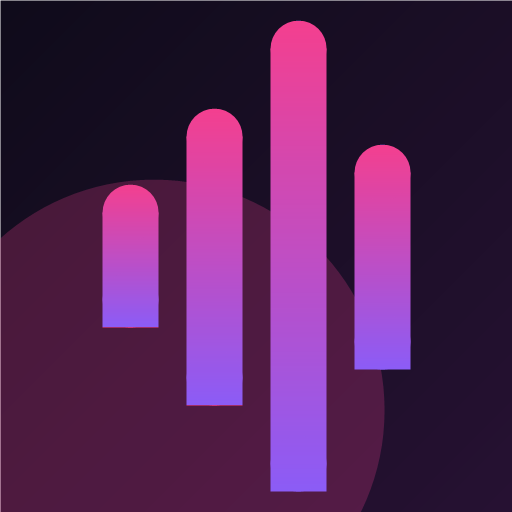

<p align="center">
  
</p>

<h1 align="center">Clubify</h1>

<p align="center">
  <strong>Make Spotify sound like it's playing in a nightclub.</strong><br>
  Clubify adds deep bass, warmth, and room echo to Spotify only. Games, Discord, and YouTube stay untouched.
</p>

<p align="center">
  <a href="https://github.com/tall1on/clubify/releases/latest"></a>
  
</p>

<!-- TODO: add a screenshot or short GIF of the Clubify window here -->

## Download

**[Download the latest version](https://github.com/tall1on/clubify/releases/latest)** and run the `Clubify_x.y.z_x64-setup.exe` installer.

- **Windows 11 only** (build 20348 or newer).
- **Updates itself.** On launch, Clubify checks for a new version and installs it automatically.
- **Starts with Windows.** It runs quietly in the system tray, near the clock. You can turn this off from the tray menu.
- **No account needed.** Clubify never asks for your Spotify login.

## Setup (one time, about 3 minutes)

Clubify needs Spotify's sound to go into a "silent" virtual speaker. Otherwise you would hear the original track and the club version at the same time.

1. **Install [VB-CABLE](https://vb-audio.com/Cable/)** (free) and restart your PC.
2. **Send Spotify to the cable.** Open Windows **Settings → System → Sound → Volume mixer**, find Spotify under Apps, and set its **Output device** to **CABLE Input**. Spotify has to be playing for it to appear in the list.
3. **Open Clubify** from the tray (bottom-right of the taskbar, near the clock), choose your headphones or speakers as the output device, and press play in Spotify.

Other apps stay on your normal speakers. To stop using the cable later, set Spotify's output device back to your default device.

### Using it

Pick a preset and adjust **bass**, **saturation**, and **room** to taste. **Bypass** instantly turns the effects off so you can compare. Settings are saved automatically.

## Presets

| Preset | Sound |
| --- | --- |
| **Afterhours** | Hollow concrete room, horn-loaded PA, distant sub. The default. |
| **Nightclub** | Warm low end, moderate drive, smooth velvet room. |
| **Deep House** | Deeper bass, long tail, gentle compression. |
| **Festival** | Loud, forward, heavily glued together. |
| **Warehouse** | Dirty saturation and a large concrete tail. |
| **Clean** | Your untouched Spotify signal with effects off. |

<details>
<summary><strong>Fine tuning</strong></summary>

Main controls: bass, saturation, room level, room distance, compression, output gain, preset selection, and bypass.

Additional controls: input trim, bass corner, low-mid scoop and frequency, PA presence and frequency, air damping, stereo width, early reflections, reverb size, damping, predelay and ducking, compressor threshold and ratio, safety buffer, auto level, and output device.

Auto level slowly normalizes quiet captures toward a music-ready level. It is on by default and can be disabled in the routing panel.

The safety buffer defaults to 48 ms. Raise it if the machine underruns, or lower it for lower latency. The reported buffer is the jitter queue; total latency also includes capture, DSP, and output.

</details>

## FAQ

**Does Clubify need my Spotify account?** No. It only listens to the Spotify app's audio on your PC and never talks to Spotify's servers.

**Does it affect other apps?** No. Only the Spotify process and its children are captured and processed.

**How do I turn the effects off?** Press **Bypass** in the UI.

**How do I stop it starting with Windows?** Right-click the tray icon and uncheck **Start with Windows**. The choice is remembered across updates.

**How do I update it?** You don't have to. Clubify updates itself automatically when it launches.

**How do I uninstall it?** Open Windows **Settings → Apps → Installed apps**, find Clubify, and uninstall. Then set Spotify's output device back to your normal speakers.

**Windows showed a security warning.** If SmartScreen appears, choose **More info → Run anyway**.

**Is it bit-perfect / lossless?** Close. See [Best quality with Spotify Lossless](#best-quality-with-spotify-lossless) below.

## Troubleshooting

**Stuck on "Waiting for Spotify"**
Spotify is open but nothing is playing, or the process name is different. Press play, then check the PID shown in the UI. Clubify captures the lowest `Spotify.exe` process and its children.

**I hear Spotify twice**
Spotify is still routed to your normal output device. Route it to the virtual cable and keep Clubify's output on your headphones.

**No virtual cable detected**
Install VB-CABLE, reboot, then restart Clubify. The warning is informational and can be dismissed if you route Spotify to a different silent endpoint.

**Audio is too quiet or too loud**
Auto level adapts slowly by design. Use input trim for manual gain and output gain for the final level, or disable auto level.

**Clicks, dropouts, or stuttering**
Raise the safety buffer, close CPU-heavy applications, or choose a different output device.

**I can't find the Clubify window**
The app starts in the tray. Left-click the tray icon, near the clock.

**Spotify sounds gritty, dull, or distorted**
Set Spotify's volume to 100% and control loudness in Clubify, set Spotify normalization to *Normal* or off, and disable Spotify's equalizer. For the cleanest path, follow [Best quality with Spotify Lossless](#best-quality-with-spotify-lossless).

## Best quality with Spotify Lossless

<details>
<summary>Click to expand the audiophile setup</summary>

For the cleanest Spotify Lossless path:

1. Set Spotify to **Lossless**, volume **100%**, normalization **Normal** or off, and disable its equalizer.
2. Open Windows **Settings → System → Sound**.
3. Set **CABLE Input** (the Spotify output) to the same rate as your headphones, for example **24-bit, 44100 Hz**.
4. Set the headphones/speakers device to the same rate, for example **24-bit, 44100 Hz**.
5. Disable audio enhancements on both devices.
6. Start Clubify; the UI shows the engine rate and the capture feed (`f32`).
7. For a bit-transparent check, select **Clean** or bypass; auto level is not applied while effects are off.

When both devices are 44.1 kHz, Spotify's 24-bit / 44.1 kHz stream stays at 44.1 kHz through Windows and the capture path, into the float32 DSP. No Clubify-side resample is inserted.

</details>

## Known limitations

- Windows x64 only for the supported capture path.
- A virtual or silent output endpoint is required to suppress the original audio.
- Spotify is detected by process name, not the Spotify Web API. No login or account access is involved.
- There is a small delay (tens of milliseconds) between Spotify and what you hear, so Clubify is not suited for watching video.
- Spotify's normalized loudness is applied before capture. Clubify cannot recover peaks removed by Spotify's *Loud* limiter, so use *Normal* or off for lossless listening.

## Development

Building Clubify, the architecture, configuration, API, release process, and developer troubleshooting live in **[CONTRIBUTING.md](CONTRIBUTING.md)**.

```powershell
npm install
npm run ui:build
npm run engine
```

Open http://127.0.0.1:8787 to control the engine from the browser.

## Third-party components

- [loopback-capture](https://github.com/WerdoxDev/loopback-capture) — MIT, vendored fork under `vendor/loopback-capture`; adds float32 capture, an explicit sample rate, `SRC_DEFAULT_QUALITY`, and silence-preserving delivery.
- [audify](https://github.com/almoghamdani/audify) — MIT, RtAudio/WASAPI output and Opus bindings.
- [Tauri](https://tauri.app) — Apache-2.0/MIT.
- Node.js runtime (MIT) is bundled in production builds.
